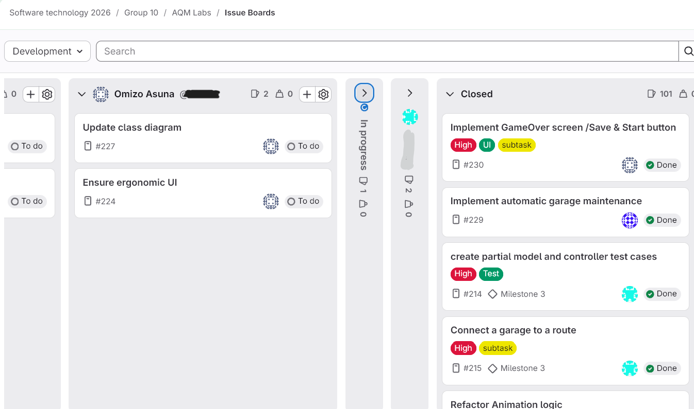

# 🚚🚗Transport Tycoon JavaFX Team Project 🛣🌳💶

[（日本語の説明はこちら）](#日本語の説明)

A team-based Java game project inspired by Transport Tycoon, developed as part of a university software development course.

## Overview

This project is a transport simulation game where players build and manage transportation infrastructure. The application is designed based on the MVC architecture to separate game logic, user interaction, and visual rendering.

This game has been built using GitLab.

## How to Play

### Important Rules

- You are the boss of a transport company and are given an initial budget. You can use it to construct transport routes and purchase vehicles.
- You make money when vehicles successfully unload materials, products, or passengers at their destinations.
- Maintenance fees apply and increase as vehicles age. If a vehicle gets too old, you can sell it.
- When you run out of budget (coins), your company goes bankrupt and the game is over.
- Forests expand their area over time. Placing roads over them costs extra money.

### 1. Download the game

To download the game, go to "Release" and click the jar file that corresponds to your computer's OS.

### 2. Make a route of transport

Make sure to construct roads so that they properly connect factories, mines, and cities.
Factories consume materials from mines, and cities then buy products from the factories. If you connect two cities and run a bus on the road between them, passengers will generate profit.

Place pieces of road first, then place stops, where vehicles load and unload goods or people. After that, place a garage, where you will be able to buy vehicles later. To create a route, click the "Place Route" button on the side bar, then click the stops that belong to the route one by one. Click "Place Route" again once you are done.

### 3. Purchase vehicles

Click the garage and choose a vehicle. There are two types: buses and trucks. Buses carry passengers, while trucks carry materials and products. Price, speed, capacity, and maintenance fee vary depending on the vehicle, so choose carefully.

## Technologies

- Java
- JavaFX
- Maven
- JUnit
- GitLab
- CI/CD pipelines

## My Contributions

- Designed UML diagrams to clarify the system architecture
- Contributed to the JavaFX-based UI implementation
- Implemented vehicle movement logic
- Worked in a team development environment using GitLab

## Architecture

The application follows the MVC pattern:

- Model: game world, entities, transport logic, and simulation state
- View: JavaFX UI and map rendering
- Controller: user input handling and coordination between Model and View

## Screenshots and Design Documents

### 1. UML Class Diagrams

I was responsible for designing these UML diagrams to clearly visualize class relationships and method responsibilities at a glance. Following the MVC architecture, they were used to support smoother team collaboration and system design.

Package

Model

View

Controller

### 2. CI/CD Pipeline

Used GitLab CI pipelines to support automated testing and collaborative development.

### 3. GitLab Team Development

These screenshots demonstrate the collaborative development workflow using GitLab, including branch management, issue tracking, task organization.

---

## 日本語の説明

大学の授業でjavaを用いてチーム開発した、Transport Tycoonを模したゲームです。
Transport Tycoonとは、プレイヤーが交通インフラを建設・運営するシミュレーションゲームです。
ゲームロジック、ユーザー操作、画面描画を分離するため、MVCアーキテクチャに基づいて設計されています。GitLabを使って開発しました。

## 遊び方

### 基本ルール

- あなたは輸送会社の社長です。ゲーム開始時に初期予算（コイン）が与えられます。この予算を使って道路を建設したり、車両を購入したりできます。
- 車両が目的地で資材、製品、乗客の荷下ろしをすると収入が得られます。
- 購入した車両には維持費が発生し、時間の経過とともに増えていきます。古くなりすぎた車両は売却して手放すことができます。
- 予算(コイン)がなくなると、会社は倒産しゲームオーバーになります。
- 森は時間の経過とともに増殖し、広がっていきます。森の上に道路を敷くと、伐採のための追加費用がかかります。

### 1. ゲームのダウンロード

ゲームをダウンロードするには、「Release」に移動し、お使いのパソコンのOSに対応したjarファイルをクリックしてください。パソコンにjavaがインストールされていることを確認してください。

### 2. 輸送ルートの作成

道路が工場、鉱山、都市を適切に結ぶように建設してください。
工場は鉱山から資材を、都市は工場から製品を仕入れます。都市同士を結んで、そこにバスを走らせると乗客から利益を得られます。

まずは道路を敷き、次に車両が荷物や人を積み下ろしする停留所を設置します。その後、ステップ3で車両を購入するための車庫を設置します。
道路のルートを決定するには、サイドバーの「Place Route」ボタンをクリックし、続けてルートに含める停留所を順番にクリックしていきます。
完了したら、もう一度「Place Route」をクリックしてください。

### 3. 車両の購入

車庫をクリックすると購入できる車両の一覧が見られます。車両にはバスとトラックの2種類があります。
バスは乗客を、トラックは資材や製品を輸送します。価格・速度・積載量・維持費は車両によって異なるため、よく検討して選びましょう！。

## 使用技術

- Java
- JavaFX
- Maven
- JUnit
- GitLab
- CI/CDパイプライン

## 担当箇所

- システム設計とUML図の作成
- UIのデザインと実装
- 車両移動ロジックの実装
- GitLabを用いたチーム開発環境の構築（CIパイプラインのメンテナンス、ブランチの保護 など)

## アーキテクチャ

このゲームはMVCパターンに倣って設計されています。

- Model: ゲームの基盤となるオブジェクト（会社、車両、土地 etc.）、工場や街などのエンティティ、輸送ロジック、ゲームの状態（所持金、プレイ時間、走行中の車両の位置 etc.）
- View: JavaFXを用いたUIとマップ描画
- Controller: ユーザー入力の処理とModel・View間の連携

## スクリーンショットと設計資料

### 1. UMLクラス図

以下は、私が設計・作成を担ったUML図です。チームメンバーが一目でクラス間の関係とメソッドの役割を理解できることを重視しました。
開発フェーズを認識の齟齬なく円滑に進めることに貢献しました。

Package

Model

View

Controller

### 2. CI/CDパイプライン

自動テストとチーム開発促進のため、GitLabのCIパイプラインを使用しました。

### 3. GitLabでのチーム開発

これらの画像は、ブランチ管理・イシュー管理・タスク管理を含む、GitLabを用いたチーム開発のワークフローの一部を切り取ったものです。

